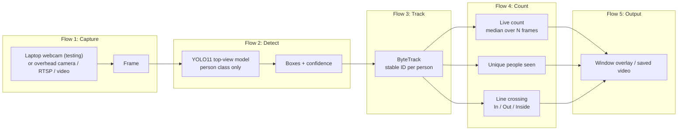
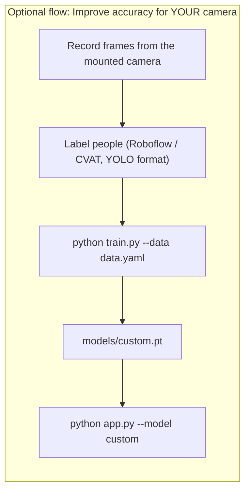

# HumanDetectionModel

Detects and counts people from an **overhead (top-down) camera**. Uses YOLO11 weights that were already fine-tuned on 3,137 top-view images, so no training is needed to start.

## System flow





## Models

| Name (`--model`) | File | Trained on | Speed (RTX 3050) | Use for |
|---|---|---|---|---|
| `top-n` (default) | `models/Yolo_v11_n.pt` | Top-view people | ~85 FPS | Live overhead counting, embedded targets |
| `top-x` | `models/Yolo_v11_x.pt` | Top-view people | ~23 FPS, most accurate | Crowded scenes, best accuracy |
| `front` | `models/yolo11n.pt` (auto-download) | COCO (side/front view) | Fast | Sanity check with the laptop webcam in front of you |
| `custom` | `models/custom.pt` | Your own overhead footage | Fast | After running `train.py` |

> The top-view models are made for a camera looking **down**. If you sit in front of the laptop, they may miss you. To test them on the laptop, tilt the screen back and hold/look down at the camera from above, or point it down at the floor. Use `--model front` to check the pipeline works with a normal front view.

## Setup

```bash
python -m venv .venv
```

```bash
.venv\Scripts\activate
```

```bash
pip install torch torchvision --index-url https://download.pytorch.org/whl/cu124
```

```bash
pip install -r requirements.txt
```

```bash
python download_models.py
```

## Run

| Task | Command | Notes |
|---|---|---|
| Laptop webcam, top-view model | `python app.py` | Camera index 0 |
| Laptop webcam, front-view check | `python app.py --model front --flip` | Normal COCO model |
| Most accurate | `python app.py --model top-x --tta` | Slower |
| Doorway in/out counting | `python app.py --line h --line-pos 0.5` | Horizontal line in the middle |
| IP / overhead camera | `python app.py --source rtsp://user:pass@ip/stream` | Any OpenCV source |
| Video file + save output | `python app.py --source clip.mp4 --save out.mp4` | |
| Test on sample overhead images | `python predict_images.py --model top-n` | Results saved to `outputs/` |

Keys in the window: `q` / `ESC` quit, `r` reset counts.

## Counters on screen

| Value | Meaning |
|---|---|
| People | People in the frame now, smoothed (median of last `--smooth` frames) so it does not flicker |
| Raw | People detected in this exact frame |
| Unique | Different tracked people seen for at least 5 frames |
| In / Out / Inside | People who crossed the counting line each way (only with `--line`) |

## Tips for the final overhead mount

| Tip | Why |
|---|---|
| Mount 2.5–4 m high, lens pointing straight down | Matches the training data |
| Cover the whole area with even lighting | Fewer missed people and shadows counted as people |
| Tune `--conf` (0.25–0.5) | Lower finds more people, higher gives fewer false boxes |
| Put the `--line` across the doorway | Gives reliable in/out counts |
| If accuracy is still low, record ~300–500 frames from the real mount, label them, run `train.py` | Adapts the model to your exact height, lens and room |

## Fine-tune (only if needed)

Dataset layout (YOLO format, one class `person`):

```
datasets/overhead/
  data.yaml
  images/train  images/val
  labels/train  labels/val
```

`data.yaml`:

```yaml
path: datasets/overhead
train: images/train
val: images/val
names:
  0: person
```

```bash
python train.py --data datasets/overhead/data.yaml --base top-n --epochs 60 --batch 8
```

## Export for the mobile app (TFLite)

The ready file is `exports/person-detector.tflite` (float32, 640x640, output `[1, 5, 8400]`). It is used by the Elevator app. To rebuild it on Windows:

```bash
.venv\Scripts\python -c "from ultralytics import YOLO; YOLO('models/Yolo_v11_n.pt').export(format='onnx', imgsz=640, opset=17, simplify=True)"
```

```bash
python -m venv .venv-export
```

```bash
.venv-export\Scripts\pip install -r requirements-export.txt
```

```bash
.venv-export\Scripts\onnx2tf -i models\Yolo_v11_n.onnx -o models\tflite_export -osd -dgc
```

```bash
.venv-export\Scripts\python verify_tflite.py models\tflite_export\Yolo_v11_n_float32.tflite
```

| Note | Why |
|---|---|
| Use the `_float32.tflite` file | The `_float16` file has float16 input/output, which the app rejects |
| `verify_tflite.py` pads with gray (114) | Same as YOLO training; black padding caused a false person in an empty frame |
| Ultralytics' own `tflite` export | Only runs on Linux/macOS now, so ONNX + `onnx2tf` is used instead |

## Project files

| File | Purpose |
|---|---|
| `app.py` | Live camera / video detection, tracking and counting |
| `predict_images.py` | Run on a folder of images and save annotated results |
| `train.py` | Fine-tune on your own overhead images |
| `download_models.py` | Download the top-view weights |
| `verify_tflite.py` | Count people with a `.tflite` export using the mobile app's exact preprocessing |
| `exports/person-detector.tflite` | Exported model used by the Elevator app |
| `requirements-export.txt` | Packages for the TFLite conversion environment |
| `people_counter/detector.py` | Model loading, detection, tracking |
| `people_counter/counter.py` | Smoothed count, unique count, line crossing |
| `people_counter/draw.py` | Boxes and info panel |
| `samples/images` | Overhead test images (not used in training) |

## Credits

Top-view weights: Hernando Cánovas, Martínez-Sala, Aarnoutse-Sánchez, Alcaraz Espín (Universidad Politécnica de Cartagena), *YOLO-based models trained via transfer learning with top-view person image annotations*, Zenodo, [record 15731095](https://zenodo.org/records/15731095), CC BY 4.0. Built on [Ultralytics YOLO](https://github.com/ultralytics/ultralytics) (AGPL-3.0).
